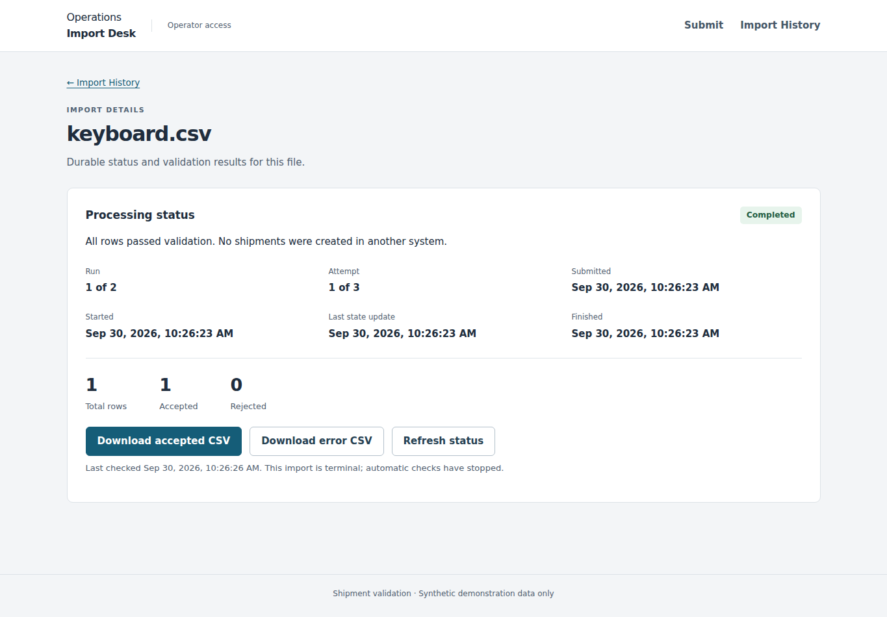

# Operations Import Desk

A small, owner-scoped shipment CSV intake tool: submit a file, follow its durable status, and download accepted rows or actionable row errors. It handles duplicate submissions and interrupted processing without asking operators to guess whether work was lost.

Independent, AI-assisted learning/hiring demonstration by Phillip-Bryan Kouokam, pursuing a first professional software engineering role. Based on public WebCreek material and the React/NestJS posting; not WebCreek's systems, clients, requirements or production architecture. All data/accounts are synthetic.

## Review in five minutes

1. Read the [article](docs/article.md) for problem, decisions, evidence and senior-review questions.
2. Inspect the [architecture](docs/architecture.md), [three ADRs](docs/adrs.md) and [generated OpenAPI](docs/openapi.json).
3. Watch the [captioned walkthrough](docs/presentation/walkthrough.mp4), or use the [spoken script](docs/presentation/spoken-script.md). Follow [setup](docs/setup.md) to run it yourself.
4. See [evidence and limitations](docs/evidence.md) and the [recovery runbook](docs/runbook.md).



## Run locally

Tested native stack: Linux x86_64, Node 24.19.0 / npm 11.9.0, Java 17, MongoDB 8.0.15, Redis 7.4.6, Keycloak 26.4.0. Start in a new checkout; see setup for OS prerequisites and browser installation.

```sh
npm ci --ignore-scripts
npm run check
npm run build:web
npm run docs:check
bash scripts/install-native-services.sh /tmp/odi-runtime
source /tmp/odi-runtime/env.sh
bash scripts/demo-native.sh
```

Open `http://127.0.0.1:5173`. Local accounts `operator-a`, `operator-b`, `viewer` share the synthetic password `Local-demo-only-123!`. The native launcher creates fresh disposable storage and imports the realm; history begins empty. Submit `samples/valid.csv` as operator-a; browser tests separately seed viewer-owned data and verify isolation. Stop the launcher with Ctrl-C. Never use these fixtures on a public host.

**M1-Docker: OPEN / UNPASSED.** Docker is unavailable in the execution environment. Existing Compose config covers MongoDB, Redis and Keycloak only; API, worker and UI run on the host. Neither dependency-container startup nor a six-service Compose workflow has been verified. Native evidence does not close this gap. A18 is therefore partial at handoff.

## Boundaries

Exactly three screens: Submit, History, Details. Code + PKCE provider redirect; in-memory tokens. Operators upload/retry their own imports; viewers read only their own imports. API enforces every boundary.

CSV: `shipment_id,origin_code,destination_code,scheduled_date,weight_kg,carrier_code`. UTF-8, <=256 KiB, <=1,000 rows, <=128 Unicode code points/cell, <=4,096 UTF-8 bytes/record. Structural rejection happens before storage; business errors become results. See the [frozen v1.1 specification](docs/design-v1.1.txt) for exact rules and state transitions. Original bytes plus SHA-256 deduplicate within owner/schema. Whole result is published in one fenced Mongo update, capped at 4 MiB including reserved overhead.

No editing, deletion, cancellation, dashboards, search, notifications, WebSockets, admin UI, caching, real logistics integration or unbounded bulk ingestion. No claim of enterprise capacity or production readiness.

## Repository map

| Path | Responsibility |
|---|---|
| `packages/input` | Pure structural/business CSV validation |
| `apps/api` | NestJS token validation, ownership, persistence, downloads/retry |
| `apps/worker` | Mongo dispatch/leases/retries, BullMQ notification consumer |
| `apps/web` | React/TypeScript three-screen workflow |
| `infra/keycloak` | Local-only realm and synthetic accounts |
| `samples` | Valid and business-invalid CSV fixtures |
| `scripts` | Native setup, disposable integration/browser harnesses, measurements, OpenAPI |
| `docs/test-output` | Historical results, screenshots, M5 raw observations |

## Validation and assistance

`npm run check` typechecks both frontend/backend and runs 41 unit tests. Real-service and browser commands are in setup. CI configuration runs these gates with real native services, but no hosted GitHub Actions run is claimed. Public release is prepared as a source ZIP and cloneable Git bundle. See [publishing instructions](docs/presentation/publish.md). GitHub publication is pending; no deployed application is claimed. The article and captioned recording live inside this repository.

OpenAI Codex assisted design, implementation, testing, investigation and writing. The applicant must review, understand and explain the code and these tradeoffs; this artifact does not establish independent mastery or prior professional NestJS, Redis, OIDC or queueing experience. Seeking feedback and mentorship from experienced engineers is part of its purpose.
