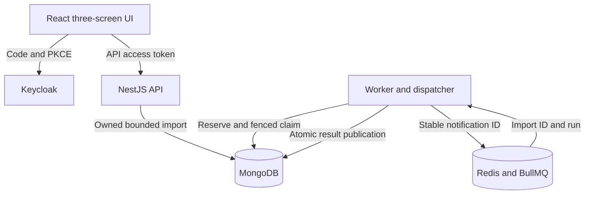

# Architecture and handoff

Mongo owns acceptance, exact input bytes, deduplication, processing eligibility, run/attempt budgets, lease and complete results. Redis carries notifications and can be reconstructed from Mongo intent. The API never needs Redis to accept an import.

## A single import

1. API verifies access token and operator role, bounds multipart bytes, parses structure, and atomically upserts owner/schema/hash. Unique index arbitrates concurrent duplicates. 202 means durable acceptance; identical bytes return 200/existing ID. Lost responses are recovered by resubmission.
2. Every five seconds the worker process recovers expired leases and scans PENDING imports. A Mongo atomic reservation advances `nextDispatchAt` by 30 seconds before enqueue. Up to 100 reservations/scan. Dispatch does not consume an attempt. Stable per-import/run BullMQ IDs bound notifications while consumers are absent. If dispatcher dies or Redis refuses enqueue, intent remains PENDING and becomes eligible later.
3. Consumer conditionally claims the current due run and increments its Mongo attempt. It gets a random lease token with 60-second expiry. Calculation has a 30-second deadline and yields every 100 rows. Business errors are rejected-row results, never infrastructure retries.
4. Publication matches import/run/state/token and unexpired database-time lease. One update publishes all counts, rows, terminal state and event. Result/document size is checked with an 8 KiB reserve against 4 MiB. A stale worker cannot undo or replace that result.
5. Transient failure returns to PENDING after 2 then 4 seconds; three claims exhaust a run. Expired leases use the same budget. Owner/operator may request one manual retry (run 2); no third run. Repeated run-1 retry request recovers the existing run 2.

Events are bounded at 32; no outbox collection or partial result collection. Mongo uses `$$NOW` for decisions and majority/journal acknowledgement. Evidence uses standalone Mongo, not replication failover. BullMQ acknowledgement is not a business-state transition.

## Security and client state

Exact configured issuer/audience and signed RS256 access-token claims are validated; ID tokens and unknown roles are rejected. Owner is issuer+subject in every import query. Foreign/nonexistent IDs both return 404; 403 means role denial and 409 means state conflict. UI does not implement alternate authorization. Public DTOs explicitly omit raw bytes, identity, hash, lease and dispatch fields; `/v1/me` intentionally exposes the caller's subject/role only.

Keycloak's public SPA client uses Code+PKCE S256 with no secret. Adapter tokens live in memory. Reload redirects through the provider session and refetches durable state. Details polls at three-second intervals only while visible and unfinished; failed status fetch preserves the last confirmed view with an unavailable label. No queue-health inference or percentage progress. Uploaded values are text nodes; authenticated CSV downloads quote cells and neutralize formula prefixes.

## Where to change things

Input schema/business rules: `packages/input`; HTTP envelope: API `upload.ts`; public projections: `store.ts`; token policy: `auth.ts`; timing/budgets/fencing: worker `state.ts`; transport: `transport.ts`; calculation/failure mapping/log allowlist: `processor.ts`; browser lifecycle: `useDetails.ts`/`auth.ts`. Keep new behavior out of this frozen demonstration without a new design review.

Generated `openapi.json` comes from explicit public schemas in `scripts/generate-openapi.mjs`; it checks all nine Nest decorator routes, not automatic runtime DTO reflection. Regenerate on approved contract changes; tests remain the behavior authority.
